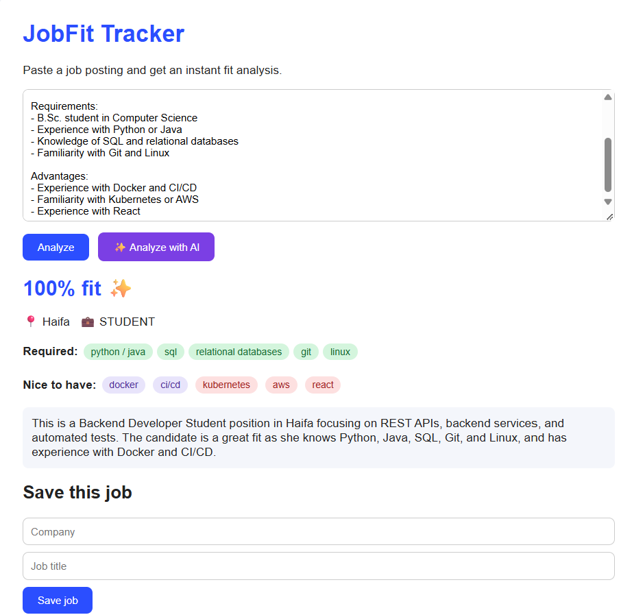

# JobFit Tracker




A web app and REST API for tracking job applications and analyzing job postings.

I built this project while searching for a student position: every day I received
several job postings and had to check the location, whether it's a student role,
which skills it requires, and whether I had already applied. JobFit Tracker
automates this.

## Features

- **Job application tracking** – full CRUD REST API (company, title, status, CV version, notes, etc.)
- **Duplicate detection** – prevents saving the same job twice (case-insensitive)
- **Job posting analyzer** – extracts location, job type and required skills from the posting text
- **Fit score** – calculates how many of the required skills I already have
- **AI analysis** – an LLM (Google Gemini) reads the posting, understands alternatives ("Java, C++, or C#") and nice-to-have skills, and writes a short fit summary
- **Auto-fill** – when a job is saved with a description, location, job type and fit score are filled automatically
- **Web interface** – paste a job posting, see the fit analysis with colored skill tags, save it, and track all applications in a table
- **Automated tests** – 17 tests with pytest (analyzer + API)

## Tech Stack

Python · Django · Django REST Framework · SQLite · Google Gemini API · pytest · Git · Docker · GitHub Actions · HTML · CSS · JavaScript

## API Endpoints

| Method | Endpoint | Description |
|---|---|---|
| GET, POST | `/api/jobs/` | List all saved jobs / add a new job |
| GET, PUT, PATCH, DELETE | `/api/jobs/<id>/` | View, update or delete a job |
| POST | `/api/analyze/` | Analyze a job posting (keyword + regex) |
| POST | `/api/analyze-ai/` | Analyze a job posting with AI (Gemini) |

## Example

`POST /api/analyze/`

```json
{"text": "Software Engineering Student - Yokneam, Part time. Linux, C++, Python, Git and Verilog."}
```

Response:

```json
{
  "location": "Yokneam",
  "job_type": "STUDENT",
  "skills_found": ["python", "c++", "linux", "git", "verilog"],
  "skills_missing": ["verilog"],
  "fit_score": 80
}
```

## Getting Started

```bash
git clone https://github.com/LirazIluz/jobfit-tracker.git
cd jobfit-tracker
python -m venv venv
venv\Scripts\activate        # on Linux/Mac: source venv/bin/activate
pip install -r requirements.txt
python manage.py migrate
python manage.py runserver
```

To use the AI analysis, create a `.env` file in the project folder with your Gemini API key
(free at https://aistudio.google.com):

```
GEMINI_API_KEY=your_key_here
```

Then open http://127.0.0.1:8000/

## Run with Docker

```bash
docker build -t jobfit-tracker .
docker run -p 8000:8000 jobfit-tracker
```

## Running Tests

```bash
pytest -v
```

## Interesting Problems

### Skill matching with regex

Simple substring matching (`"git" in text`) produced false positives –
"git" was found inside "digital" and "rest" inside "interested".
I fixed it using regular expressions with lookarounds:

```python
pattern = r"(?<![a-z0-9])" + re.escape(skill) + r"(?![a-z0-9+#])"
```

I used lookarounds instead of `\b` because `\b` doesn't work for skills
that end with non-word characters, such as `c++` and `c#`.

Adding "c" as a skill revealed another bug: it was matched inside "c++".
The tests caught it, and I fixed it by also excluding "+" and "#" after a match.

Later, testing on a real job posting revealed the same bug in location detection:
"Omer" was found inside "customers". I applied the same regex fix to
location and job-type detection and added tests for it.

### Keyword matching vs. AI

Keyword matching can't understand context: for "Java, C++, or C#" it marked C# as
missing, and it treated "Kubernetes – advantage" as a requirement.
I added an AI analysis with Gemini. At first the model also marked C# as missing,
so I improved the prompt: alternatives are returned as one item ("java / c++ / c#"),
with an explicit example, and related skills are treated as the same
(git = version control).

## Roadmap

- [x] Web interface (HTML/CSS/JavaScript)
- [x] Docker and GitHub Actions CI
- [x] AI-based posting analysis (LLM)
- [ ] Deploy to the cloud